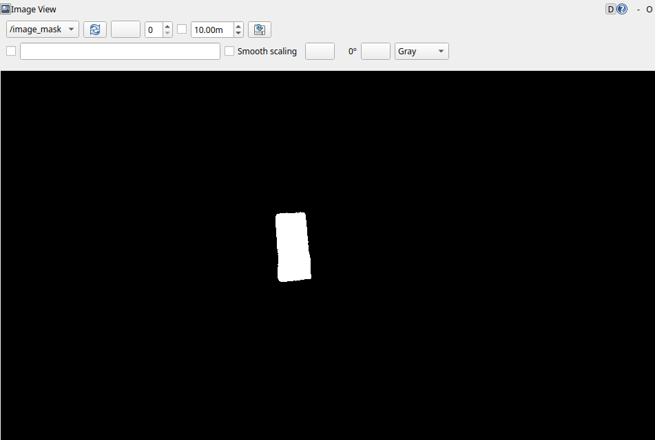
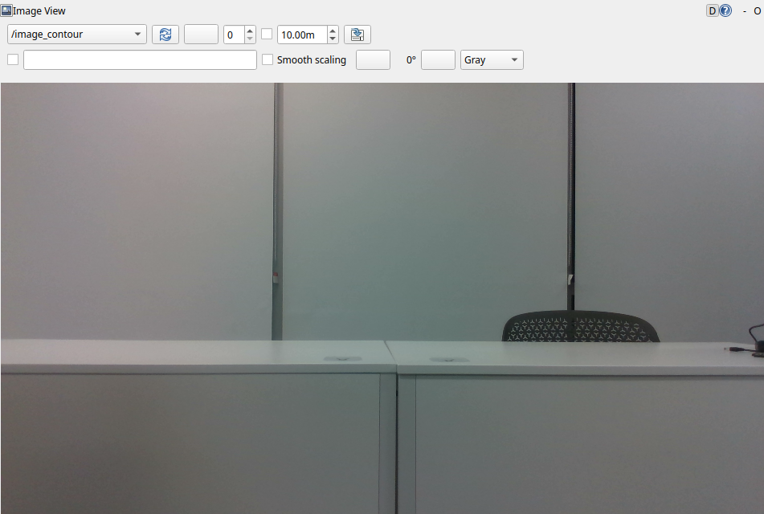
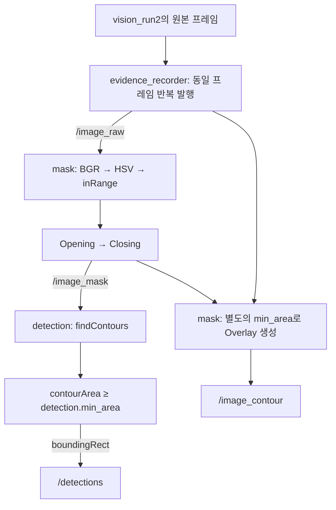
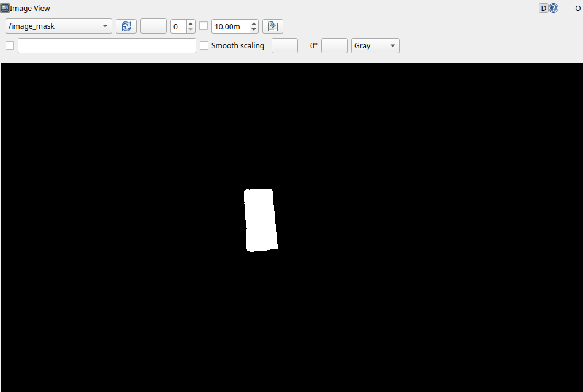
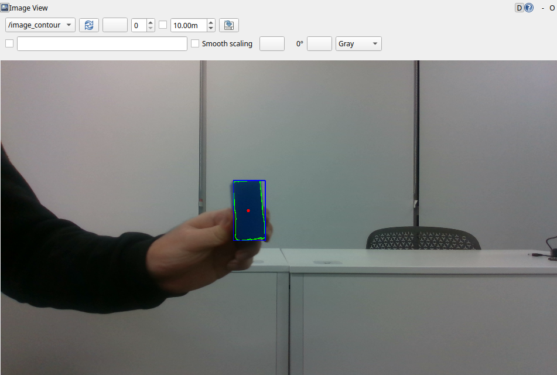
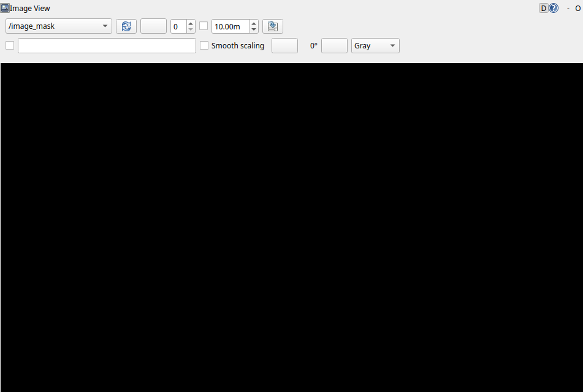

# HSV 기반 파란 물체 검출 비교 실험 보고서

## 1. 기존 비전 노드 실행과 토픽 구조 확인

입력은 로컬 rosbag `vision_run2`를 사용했다. 원본 bag은 저장소에 포함하지 않으며, 수신 이미지·검출 메시지·적용값은 `results/`에 제출했다.

### 1.1 토픽 목록과 발행·구독 정보

| 자료 | 토픽 | 메시지 타입 | 이번 실험의 발행 노드 | 구독·수신 도구 |
| --- | --- | --- | --- | --- |
| Raw Image | `/image_raw` | `sensor_msgs/msg/Image`, bgr8 | `/evidence_recorder` | `/mask`, 증거 수신기, rqt_image_view |
| Mask | `/image_mask` | `sensor_msgs/msg/Image`, mono8 | `/mask` | `/detection`, 증거 수신기, rqt_image_view |
| Overlay | `/image_contour` | `sensor_msgs/msg/Image`, bgr8 | `/mask` | 증거 수신기, rqt_image_view |
| 검출 결과 | `/detections` | `vision_msgs/msg/Detection2DArray` | `/detection` | 증거 수신기 → YAML 저장 |


## 2. Raw Image 토픽 받아보기

rqt_image_view에서 `/image_raw`를 선택해 원본 영상을 확인했다. 아래 화면 상단에 선택한 토픽 이름이 표시되어 있다. 과제의 2~4번 확인에는 실험 1-A의 동일 입력 자료를 사용했다.


| 항목 | 확인값 |
| --- | --- |
| 토픽 | `/image_raw` |
| 해상도 | 1920×1080 px |
| encoding | `bgr8` |
| 원본 시각 | 1791802701.721855617 |
| frame_id | `camera_color_optical_frame` |

목표는 화면 중앙 왼쪽에서 손에 들고 있는 파란 직육면체 블록 1개이다. 

## 3. Mask 토픽 받아보기

### 3.1 수신 화면과 Raw 비교

같은 원본 Header를 가진 `/image_mask`를 rqt_image_view로 구독했다. 아래 캡처는 1-A 설정인 H=104~120, S=200~255, V=8~255, kernel_size=5의 결과이다.




| 구분 | 실제 값·의미 | Raw와 비교한 관찰 |
| --- | --- | --- |
| 전경 | mono8의 255. HSV 조건과 형태학 처리를 거쳐 남은 영역 | 파란 블록 위치에 흰 영역 1개가 남았다. |
| 배경 | mono8의 0. 처리 결과에서 제외된 영역 | 화이트보드·책상·의자·손·소매는 검게 나타났다. |
| 목표 외 영역 | 외부 Contour 총 1개 | 블록과 떨어진 별도 배경 영역은 관찰되지 않았다. |
| 목표 영역의 차이 | A의 흰 픽셀 18,256개 | S 하한을 150으로 낮춘 B보다 경계 영역이 좁았다. B에서 1,327픽셀이 추가되었다. |


### 3.2 Mask 생성·발행 코드와 설정 적용

| 위치 | 처리 내용 |
| --- | --- |
| [mask.cpp](vision/src/vision/src/mask.cpp), 16~25행 | HSV 경계, kernel_size, Overlay용 min_area 파라미터 선언 |
| `mask.cpp`, 33~35행 | `/image_raw` 구독 후 `onImage()` 실행 |
| `mask.cpp`, 50~61행 | 프레임마다 `get_parameter()`로 현재 설정 읽기 |
| `mask.cpp`, 65~66행 | BGR→HSV 변환 후 `inRange(hsv, low, high, mask)` |
| `mask.cpp`, 69~71행 | 5×5 타원형 커널의 Opening→Closing |
| `mask.cpp`, 91행 | 원본 Header와 `mono8` 인코딩으로 `/image_mask` 발행 |

`inRange`는 H·S·V가 각각 하한 이상, 상한 이하인 픽셀을 255로 설정한다. 그 뒤 Opening/Closing이 작은 영역과 경계를 처리한다.


## 4. 검출 결과 토픽 받아보기

### 4.1 실제 수신 메시지와 필드

`/detections`를 `Detection2DArray` Subscriber로 수신해 YAML로 저장했다. 다음은 [1-A 수신 메시지 원본](results/exp1_A/detections.yaml)에서 분석에 사용한 필드만 발췌한 것이다. 생략된 기본값 필드는 원본 파일에서 확인할 수 있다.

```yaml
header:
  stamp:
    sec: 1791802701
    nanosec: 721855617
  frame_id: camera_color_optical_frame
detections:
- results:
  - hypothesis:
      class_id: blob
      score: 1.0
  bbox:
    center:
      position:
        x: 856.5
        y: 515.5
      theta: 0.0
    size_x: 105.0
    size_y: 205.0
  id: ''
```

| 실제 필드 | 의미와 단위 |
| --- | --- |
| `header.stamp` | 원본 입력 프레임 시각, sec·nanosec |
| `header.frame_id` | 원본 카메라 좌표계 이름 |
| `detections[]` | 검출 목록. 배열 길이가 검출 수이며 빈 배열은 검출 없음 |
| `detections[i].header` | 원본 Mask와 같은 Header |
| `bbox.center.position.x`, `.y` | 축 정렬 박스 중심, px. 영상 왼쪽 위 기준으로 오른쪽·아래 방향 증가 |
| `bbox.size_x`, `.size_y` | 박스 너비·높이, px |
| `results[0].hypothesis.class_id` | 코드가 넣은 클래스 이름 `blob` |
| `results[0].hypothesis.score` | 항상 1.0으로 지정한 무단위 값. 학습 모델이 산출한 신뢰도가 아님 |
| `bbox.center.theta`, `id`, `results[0].pose` | 코드에서 별도로 계산하지 않은 기본값. 회전·추적 ID·3D 자세 결과로 해석하지 않음 |

메시지에는 **Contour 면적 필드나 별도 검출 여부 bool 필드가 없다.** 보고서의 면적은 수신 Mask에서 별도로 측정했으며, 검출 여부는 `detections` 배열로 판단했다.

### 4.2 Overlay와 목표 위치 확인


초록 윤곽선과 파란 박스는 Raw의 파란 블록 위치를 둘러쌌고, 빨간 점도 블록 안에 표시되었다. 1-A의 박스 좌상단은 (804,413), 크기는 105×205 px이며 메시지의 박스 중심은 (856.5,515.5) px였다.

| Overlay 표시 | 생성 방식 |
| --- | --- |
| 초록 윤곽선 | `drawContours` |
| 파란 박스 | `boundingRect` |
| 빨간 중심점 | `moments`로 계산한 Contour 무게중심 |

빨간 점은 **Contour 무게중심**이고 메시지의 중심은 **Bounding Box 중심**이므로 두 좌표가 반드시 같지는 않다. `/image_contour`는 `/mask`가 별도 면적 기준으로 생성한다. 실험 2-B처럼 `/detection.min_area`만 바꾸면 Overlay 박스가 남아 있어도 검출 메시지에서는 후보가 탈락할 수 있다.

목표가 없는 입력에서는 박스·윤곽선·중심점 없이 배경만 표시되었으며, 검출 메시지는 `detections: []`였다.



### 4.3 검출 코드와 데이터 흐름

| 위치 | 처리 내용 |
| --- | --- |
| [detection.cpp](vision/src/vision/src/detection.cpp), 23~25행 | `/image_mask`를 구독하고 `onMask()` 실행 |
| `detection.cpp`, 39~49행 | 현재 min_area 읽기, findContours, `contourArea < min_area` 후보 제외 |
| `detection.cpp`, 51~65행 | boundingRect, 박스 중심·크기·클래스 작성 |
| `detection.cpp`, 68행 | 후보가 없어도 `/detections` 메시지 발행 |
| `detection.cpp`, 75~86행 | 빈 배열일 때 로그 생략, 검출이 있을 때 약 0.5초 간격으로 출력 |
| `mask.cpp`, 78~92행 | 별도 면적 기준으로 Overlay를 그리고 `/image_contour` 발행 |

Raw Image 수신 → HSV Mask 생성 → Opening/Closing → Contour 추출 → 면적 필터 → Bounding Box 작성 → 검출 결과 발행 순서로 처리했다.



## 5. 설정값을 바꿔 변화 검증하기

### 5.1 가설과 A·B값

실행 전 가설은 [hypotheses.txt](results/hypotheses.txt)에 기록했다. 이전 예비 실험과 같은 비교 수치를 사용했으며, bag 프레임 선정 과정에서는 Python으로 Mask를 사전 탐색했다. 아래 최종 결과는 실제 C++ 노드가 발행한 토픽을 수신해 검증한 값이다.

| 실험 | 변경 변수 | A | B | 예상 변화와 이유 |
| --- | --- | --- | --- | --- |
| 1 — Mask 생성 | `/mask`의 `s_low` | 200 | 150 | 채도 하한을 낮추면 S=150~199의 파란 영역도 통과해 목표 Mask가 넓어질 수 있고, 배경도 추가로 남을 수 있다. |
| 2 — 후보 필터 | `/detection`의 `min_area` | 500.0 px² | 20000.0 px² | 면적 500 이상 20000 미만인 후보가 탈락한다. 목표도 작으면 누락된다. 동일 입력의 Mask는 변하지 않을 것으로 예상했다. |

S는 OpenCV 8-bit HSV에서 0~255 범위이고 단위는 없다. H는 0~179 범위이다. `min_area`는 Contour 면적의 하한이며 단위는 px²이다. 코드에 별도 범위 검증은 없지만 이 실험에서는 양수만 사용했다.

### 5.2 통제 조건과 실제 적용값

| 설정 | 1-A | 1-B | 2-A | 2-B |
| --- | --- | --- | --- | --- |
| H 하한~상한 | 104~120 | 104~120 | 104~120 | 104~120 |
| S 하한~상한 | **200**~255 | **150**~255 | 150~255 | 150~255 |
| V 하한~상한 | 8~255 | 8~255 | 8~255 | 8~255 |
| kernel_size | 5 | 5 | 5 | 5 |
| `/mask.min_area` | 500.0 | 500.0 | 500.0 | 500.0 |
| `/detection.min_area` | 500.0 | 500.0 | **500.0** | **20000.0** |
| 입력·해상도 | 동일 프레임, 1920×1080 | 동일 | 동일 | 동일 |

각 노드의 파라미터 서비스를 통해 읽은 값은 아래 각 묶음의 `metrics.json`에 저장했다. 두 노드는 프레임마다 `get_parameter()`를 호출하므로 실행 중 변경도 가능하다. 이번에는 각 조건마다 노드를 새로 시작하면서 `--ros-args -p`로 값을 명시했다. 그래서 조건 사이에 재빌드는 필요하지 않았다.

네 조건의 원본 Header와 Raw 픽셀 SHA-256이 모두 같다.

```text
header.stamp: 1791802701.721855617
Raw pixel SHA-256:
5dfa08e5e42a276023ea3cdd53fb69b3c2f556d2a021117145d7a92406180288
```

검출 수·중심·박스 크기는 Overlay를 세어 추정한 값이 아니라 수신한 `/detections` 메시지의 값이다. Contour 면적은 수신 Mask에 코드와 같은 `RETR_EXTERNAL`, `CHAIN_APPROX_SIMPLE`, `contourArea`를 적용해 측정했다. Mask의 흰 픽셀 수와 Contour 면적은 서로 다른 측정값이다. 목표와 불필요한 검출의 구분은 Raw·Overlay를 사람이 대조한 결과이다.

### 5.3 실험 1 — s_low 200 → 150

| 항목 | 1-A: 200 | 1-B: 150 |
| --- | --- | --- |
| Mask 흰 픽셀 수 | 18,256 | 19,583 |
| Contour 수·면적 | 1개, 17,969 px² | 1개, 19,288 px² |
| 검출 메시지의 후보 수 | 1 | 1 |
| 목표 검출 | 검출 | 검출 |
| 불필요한 검출 | 0 | 0 |
| 박스 좌상단 (x,y), px | (804,413) | (800,412) |
| 박스 중심 (x,y), px | (856.5,515.5) | (855.5,515.5) |
| 박스 크기 (w×h), px | 105×205 | 111×207 |

**1-A 수신 자료** — [검출 메시지](results/exp1_A/detections.yaml), [실제 설정·수치·Header](results/exp1_A/metrics.json)

**Raw Image — /image_raw**


**Mask — /image_mask**


**Overlay — /image_contour**


**1-B 수신 자료** — [검출 메시지](results/exp1_B/detections.yaml), [실제 설정·수치·Header](results/exp1_B/metrics.json)

**Raw Image — /image_raw**


**Mask — /image_mask**


**Overlay — /image_contour**


**분석:** S 하한을 낮추자 흰 픽셀이 1,327개, 약 7.27% 증가했다. 박스는 가로 6 px, 세로 2 px 커졌다. `mask.cpp`의 `inRange` 조건 중 `200 ≤ S ≤ 255`가 `150 ≤ S ≤ 255`로 완화되고, H·V 조건은 유지되어 파란 블록의 경계 영역이 더 남은 결과이다. 이후 Opening/Closing을 거치므로 추가 픽셀을 모두 원래 S=150~199인 픽셀과 일대일로 대응시키지는 않았다. 이 프레임에서는 배경 Contour가 새로 생기지 않았고 불필요한 검출도 0개였다.

**선택:** 이번 입력에서는 목표 영역을 더 보존하면서 검출 수와 불필요한 검출 수를 유지한 **B=150**을 선택했다. A에서도 목표는 검출됐으므로 검출 성공률이 개선됐다고 말할 수는 없다.

### 5.4 실험 2 — min_area 500 → 20000

| 항목 | 2-A: 500.0 px² | 2-B: 20000.0 px² |
| --- | --- | --- |
| HSV | H 104~120, S 150~255, V 8~255 | 동일 |
| Mask 흰 픽셀 수 | 19,583 | 19,583 |
| Contour 수·면적 | 1개, 19,288 px² | 1개, 19,288 px² |
| 면적 필터 | 통과 | 탈락 |
| 검출 메시지의 후보 수 | 1 | 0 |
| 목표 상태 | 검출 | **미검출: 목표 누락** |
| 불필요한 검출 | 0 | 0 |
| 박스 중심·크기 | (855.5,515.5), 111×207 px | 없음 |

**2-A 수신 자료** — [검출 메시지](results/exp2_A/detections.yaml), [실제 설정·수치·Header](results/exp2_A/metrics.json)

**Raw Image — /image_raw**


**Mask — /image_mask**



**Overlay — /image_contour**


**2-B 수신 자료** — [검출 메시지](results/exp2_B/detections.yaml), [실제 설정·수치·Header](results/exp2_B/metrics.json)

**Raw Image — /image_raw**


**Mask — /image_mask**


**Overlay — /image_contour**



2-B에서 실제로 받은 검출 메시지는 다음과 같다.

```yaml
header:
  stamp:
    sec: 1791802701
    nanosec: 721855617
  frame_id: camera_color_optical_frame
detections: []
```

**분석:** 19,288 < 20,000이므로 `detection.cpp`의 면적 조건에서 목표 후보가 제외됐다. Mask는 후보 필터 이전 단계의 결과라 두 조건에서 픽셀 단위로 같았다. 두 Mask의 SHA-256은 모두 `7163cea57ed902cfed6dda8044d47a005362e859d91c507f7b8676a2ca7eab8c`이다.

**2-B의 Overlay에는 박스가 계속 보였다.** `/mask.min_area`는 통제 조건에 따라 500으로 유지했으며, 변경한 값은 `/detection.min_area` 하나뿐이기 때문이다. Overlay만 보면 실제 검출 메시지의 탈락을 놓칠 수 있으므로 `/detections`를 함께 확인해야 한다.

**선택:** 이번 입력에서는 **A=500.0 px²**를 선택했다. B는 불필요한 검출을 더 줄이지 못하면서 목표를 누락했다. 다만 잡음 후보가 없는 한 프레임이므로 500이 잡음 제거에 최적이라는 뜻은 아니다.

### 5.5 목표가 없는 입력 확인

선택한 설정 `s_low=150`, `/detection.min_area=500.0`으로 bag 첫 프레임을 처리했다. Raw에는 블록이 없고, Mask의 흰 픽셀은 0개, Contour는 0개, 검출 배열은 비어 있었다.

**Raw Image — /image_raw**


**Mask — /image_mask**



**Overlay — /image_contour**


[빈 검출 메시지 원본](results/no_target/detections.yaml) · [설정·측정값](results/no_target/metrics.json) · [연속 10프레임 수신 확인](results/no_target/liveness.json)

```yaml
header:
  stamp:
    sec: 1791802696
    nanosec: 684268028
  frame_id: camera_color_optical_frame
detections: []
```

관찰한 첫 10개 프레임의 원본 시각은 1791802696.684268028~1791802696.984679742(약 0.300초)이다. 이 프레임들을 순서대로 발행하고, 각 프레임에서 Raw·Mask·Overlay·검출 메시지의 Header가 일치하는지 확인했다. 원본 시각이 증가하는 동안 빈 검출 메시지가 계속 수신되므로 노드 중단과 구분할 수 있었다. 콘솔에 검출 로그가 없는 이유는 `detections.empty()`이면 로그 함수만 반환하기 때문이며, 검출 메시지 발행은 그 전에 수행된다.

### 5.6 선택값과 결론

| 실험 | 변경 변수 | A값 | B값 | 예상 변화 | 실제 Mask·검출 변화 | 선택값과 이유 |
| --- | --- | --- | --- | --- | --- | --- |
| 1 | `/mask.s_low` | 200 | 150 | 낮은 채도의 파란 영역 추가 통과 | 흰 픽셀 18,256→19,583, 검출 1→1, 불필요한 검출 0→0 | **150**: 이번 프레임에서 목표 영역을 더 보존 |
| 2 | `/detection.min_area` | 500.0 | 20000.0 | 작은 면적 후보 탈락, Mask 동일 | Mask 동일, 19,288 px² 후보 탈락, 검출 1→0 | **500.0**: 불필요한 검출 증가 없이 목표 누락 방지 |

최종 선택은 **H=104~120, S=150~255, V=8~255, kernel_size=5, 두 노드의 min_area=500.0 px²**이다. 다음처럼 명시적으로 실행할 수 있다.

```bash
ros2 run vision mask --ros-args -p h_low:=104 -p h_high:=120 -p s_low:=150 -p s_high:=255 -p v_low:=8 -p v_high:=255 -p kernel_size:=5 -p min_area:=500.0
ros2 run vision detection --ros-args -p min_area:=500.0
```

**오검출**은 목표가 아닌 배경 등을 목표로 검출하는 것이고, **미검출**은 실제 목표가 있는데 검출하지 못하는 것이다. 이번 2-B는 Raw에 목표가 있고 Mask에도 남았지만 면적 조건 때문에 검출이 없어졌으므로 미검출이다. 반면 목표 없는 프레임의 빈 배열은 목표가 없다는 정상적인 결과이며, 목표 누락 오류와 구분한다.
